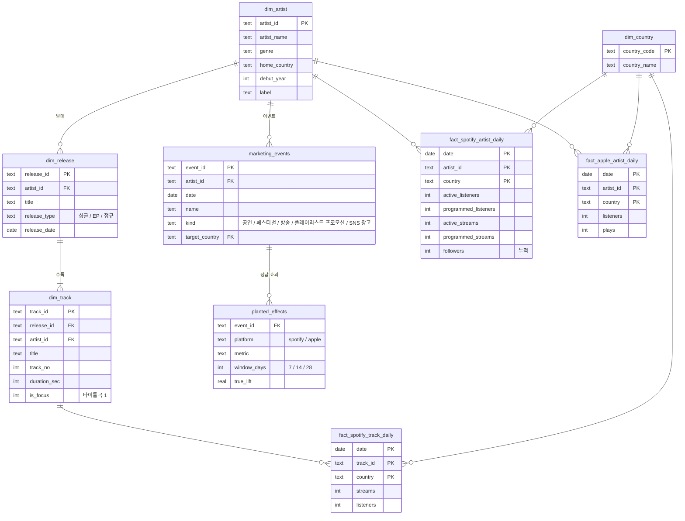

# 데이터 구조

가상 아티스트 11명의 합성 스트리밍 데이터(2025-01-01 ~ 2026-11-22, 5개국: KR·JP·US·TW·ID). 모든 이름과 값은 `generate_data.py`가 지어낸 것이며 실제 아티스트와 무관하다.

## 관계도



## 테이블 요약

| 테이블 | 단위 (한 행 = ) | 행 수 | 비고 |
| --- | --- | --- | --- |
| `dim_artist` | 아티스트 | 11 | |
| `dim_release` | 발매 | 46 | 2021~2023 카탈로그 + 2024~2025 신규 발매 |
| `dim_track` | 곡 | 289 | 발매마다 타이틀곡(`is_focus=1`) 하나 |
| `dim_country` | 국가 | 5 | KR, JP, US, TW, ID |
| `marketing_events` | 이벤트 | 44 | 아티스트당 3~5개. 아티스트마다 하나는 신규 발매 7~12일 뒤에 배치 (교란 사례) |
| `planted_effects` | 이벤트 × 플랫폼 × 지표 × 기간 | 1,056 | 생성기에 심어 둔 정답. 검증용 |
| `fact_spotify_artist_daily` | 날짜 × 아티스트 × 국가 | 32,164 | Spotify for Artists 국가별 화면에 해당 |
| `fact_apple_artist_daily` | 날짜 × 아티스트 × 국가 | 32,164 | Apple Music for Artists에 해당 |
| `fact_spotify_track_daily` | 날짜 × 곡 × 국가 | 720,324 | 발매 전과 스트림 0인 날은 행이 없음. `.csv.gz` |

## 지켜지는 규칙 (생성 후 검증함)

- 곡 스트림 합계 = 아티스트 스트림. `SUM(track.streams)`를 날짜·아티스트·국가로 묶으면 `active_streams + programmed_streams`와 정확히 같다.
- 곡 청취자는 **합칠 수 없다.** 한 사람이 여러 곡을 들으므로 곡 청취자 합 > 아티스트 청취자다. 국가별 청취자 합도 같은 이유로 근사치다.
- 곡은 소속 발매의 `release_date` 이전에는 스트림이 없다.
- `dim_track.artist_id`는 소속 발매의 `artist_id`와 같다 (조인 편의용 중복 컬럼).

## 이벤트 효과를 볼 때 쓰는 조인

```sql
-- 이벤트 하나의 대상 국가 vs 나머지 국가, 이벤트 전후 14일
SELECT f.date,
       CASE WHEN f.country = e.target_country THEN 'target' ELSE 'control' END AS grp,
       SUM(f.active_listeners + f.programmed_listeners)                         AS listeners,
       SUM(f.active_streams + f.programmed_streams) * 1.0
         / SUM(f.active_listeners + f.programmed_listeners)                      AS streams_per_listener
FROM marketing_events e
JOIN fact_spotify_artist_daily f
  ON f.artist_id = e.artist_id
 AND f.date BETWEEN e.date - INTERVAL 14 DAY AND e.date + INTERVAL 13 DAY
WHERE e.event_id = 'E001'
GROUP BY f.date, grp
ORDER BY grp, f.date;
```

```sql
-- 이벤트 뒤 14일 동안 어떤 곡이 가장 많이 늘었나
SELECT t.title, r.title AS release, t.is_focus,
       SUM(CASE WHEN s.date <  e.date THEN s.streams END) AS pre,
       SUM(CASE WHEN s.date >= e.date THEN s.streams END) AS post
FROM marketing_events e
JOIN dim_track t   ON t.artist_id = e.artist_id
JOIN dim_release r ON r.release_id = t.release_id
JOIN read_csv('data/fact_spotify_track_daily.csv.gz') s
  ON s.track_id = t.track_id AND s.country = e.target_country
 AND s.date BETWEEN e.date - INTERVAL 14 DAY AND e.date + INTERVAL 13 DAY
WHERE e.event_id = 'E001'
GROUP BY ALL
ORDER BY post - pre DESC;
```

(DuckDB 문법 기준)
